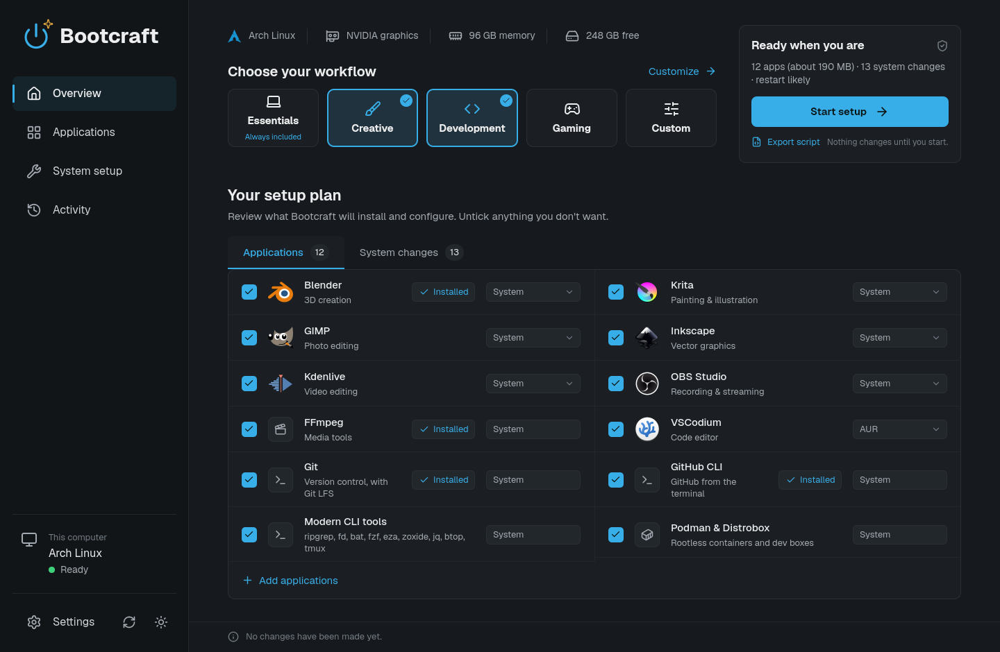
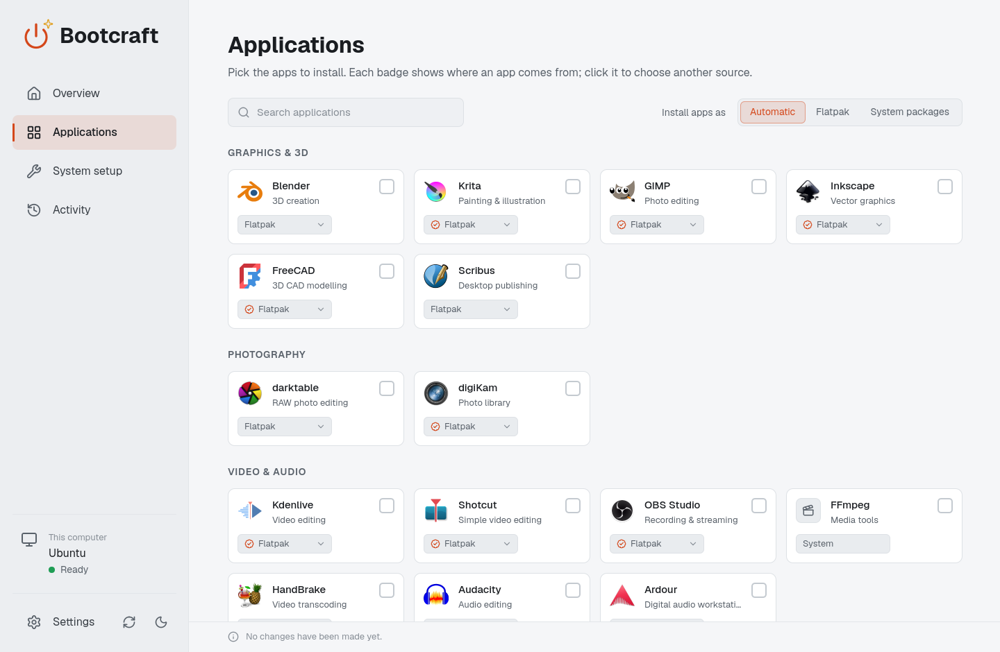
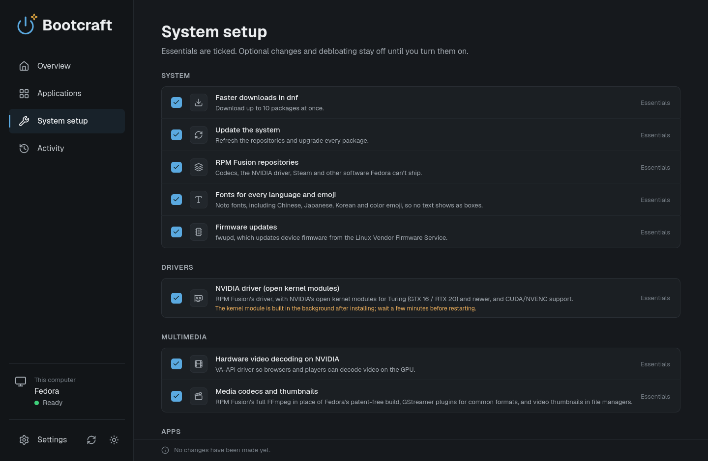
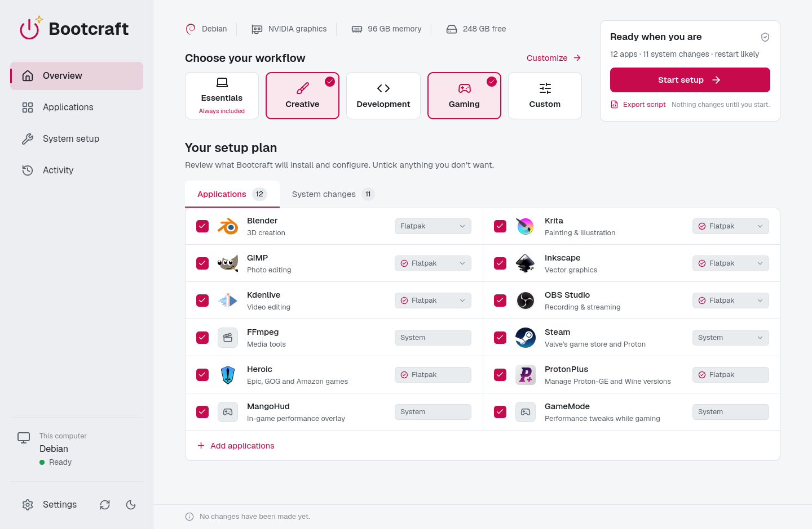
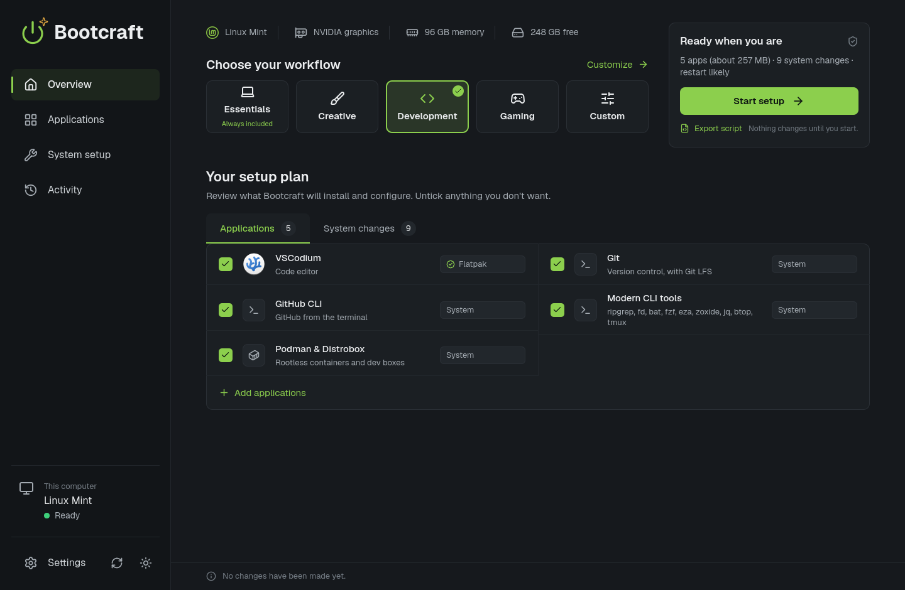
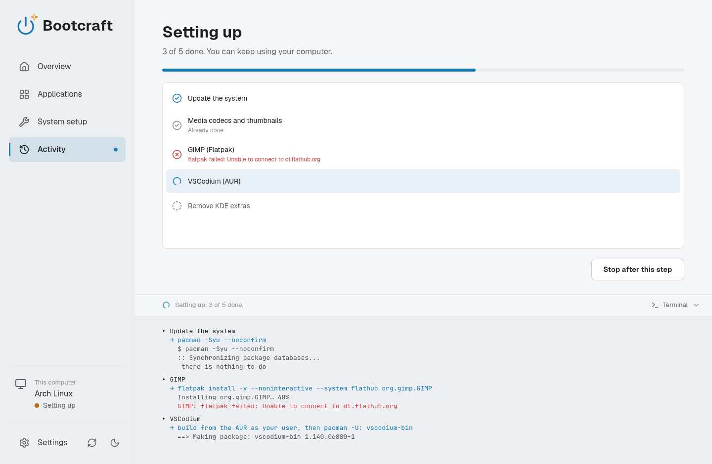

<p align="center">
  <picture>
    <source media="(prefers-color-scheme: dark)" srcset="docs/brand/bootcraft-logo-dark.svg">
    
  </picture>
</p>

<p align="center">
  <b>Set up a fresh Linux install in one go: drivers, codecs, Flatpak, your apps.</b><br>
  For Fedora, Arch Linux, Ubuntu, Linux Mint and Debian.
</p>

<p align="center">
  <a href="https://github.com/ArcticLatent/Bootcraft/releases/latest"></a>
  <a href="https://github.com/ArcticLatent/Bootcraft/actions/workflows/ci.yml"></a>
  <a href="LICENSE"></a>
</p>

<p align="center">
  
</p>

Bootcraft looks at your computer, suggests a setup for it, and shows you every
change before it makes one. Pick a workflow (Creative, Development, Gaming),
untick what you don't want, and press **Start setup**. It is the successor to
the [post-linux](https://github.com/ArcticLatent/post-linux) script, rebuilt as
a native Qt Quick desktop app in Rust.

- **The right driver for your card.** NVIDIA's open modules for Turing and
  newer, the 580 legacy driver for Maxwell, Pascal and Volta, video decoding,
  and codecs the distribution can't ship.
- **About 75 curated apps**, from Flathub or your distribution's own packages:
  Bootcraft picks per app and distribution, and you can override it.
- **Nothing hidden.** The whole plan is shown first, what is already in place
  is skipped, and any plan can be exported as a bash script.
- **Optional extras, off by default:** debloating, Snap to Flatpak on Ubuntu,
  a firewall.
- **Dark and light themes in your distribution's colours.**

> **Status:** first release. Every task and package name is tested in
> containers on each distribution; the NVIDIA driver tasks have run on real
> hardware on Arch so far. Bug reports are welcome.

## Screenshots

<table>
  <tr>
    <td></td>
    <td></td>
  </tr>
  <tr>
    <td align="center"><sub>Ubuntu: apps from Flathub, each with its source</sub></td>
    <td align="center"><sub>Fedora: RPM Fusion, the NVIDIA driver and codecs</sub></td>
  </tr>
  <tr>
    <td></td>
    <td></td>
  </tr>
  <tr>
    <td align="center"><sub>Debian: Creative and Gaming stacked</sub></td>
    <td align="center"><sub>Linux Mint: the Development workflow</sub></td>
  </tr>
  <tr>
    <td colspan="2"></td>
  </tr>
  <tr>
    <td colspan="2" align="center"><sub>A setup running: progress per task, and the commands and their output in the terminal below</sub></td>
  </tr>
</table>

## Install

Download the file for your system from the
[latest release](https://github.com/ArcticLatent/Bootcraft/releases/latest):

| System | File | Install |
|:--|:--|:--|
| **Arch Linux** | `bootcraft-<version>-1-x86_64.pkg.tar.zst` | `sudo pacman -U ./bootcraft-*.pkg.tar.zst` |
| **Fedora 44+** | `bootcraft-<version>-1.fc44.x86_64.rpm` | `sudo dnf install ./bootcraft-*.rpm` |
| **Debian 13, Ubuntu 26.04** | `bootcraft_<version>-1_amd64.deb` | `sudo apt install ./bootcraft_*.deb` |
| **Ubuntu 24.04, Linux Mint 22** (or any of them) | `Bootcraft-<version>-x86_64.AppImage` | `chmod +x Bootcraft-*.AppImage`, then run it |

Then open **Bootcraft** from your applications menu. It runs as you and asks
for your password (through polkit) only when you start the setup.

Every release has a `SHA256SUMS` file, and a `linux-release.json` listing each
file's SHA-256, signed with Bootcraft's release key.

### Updates

Bootcraft checks for a new version when it starts and shows a dot on the
update button next to Settings. **Settings → Updates** installs it: Bootcraft
downloads the new version, checks the release's signature and the file's
checksum, and restarts. The AppImage replaces itself; the packages are
installed with your package manager after a password prompt.

## What it does

- **Detects instead of asking.** Distribution and release (from
  `os-release`), desktop and session, every GPU (read from sysfs), the NVIDIA
  driver branch each card needs, Secure Boot state and installed kernels.
- **Shows the plan first.** Each task is made of plain-data steps (package
  installs, structured config edits, commands without a shell), so the full
  plan can be reviewed before anything runs.
- **Skips what is already done.** Package databases and config files are
  checked directly, including packages that only *provide* what a task needs
  (for example a custom `nvidia-open-dkms-tkg` build).
- **Opinionated steps are opt-in.** Debloat tasks live in their own section
  and are never ticked by default.
- **Fails safely.** A failed task skips only the tasks that need it; config
  files are written atomically with a `.bootcraft.bak` of the original; every
  run is logged to `/var/log/bootcraft/`.
- **AUR without sudo prompts.** AUR dependencies are resolved by Bootcraft,
  packages are built as your user in `~/.cache/bootcraft/aur` and installed
  with `pacman -U`.
- **Exports a script.** Any plan can be saved as a standalone bash script that
  does the same steps, for review or for machines without Bootcraft.

### Per distribution

| | Repositories it enables | NVIDIA driver | Extras |
|:--|:--|:--|:--|
| **Arch** | multilib | `nvidia-open` (or DKMS); AUR `nvidia-580xx` for legacy cards | yay, pacman colors, Mint look on Cinnamon |
| **Fedora** | RPM Fusion | `akmod-nvidia`; `akmod-nvidia-580xx` for legacy cards | full FFmpeg and AMD/Intel video decoding from RPM Fusion, parallel dnf downloads |
| **Debian 13** | contrib, non-free | NVIDIA's repository (pinned keyring); Debian's 550 for legacy cards | sudo for your account, optional backports kernel |
| **Ubuntu** | universe, multiverse | newest open driver from `ubuntu-drivers`; up to 580 for legacy cards | optional Snap → Flatpak with Firefox from Mozilla's repository |
| **Mint** | (already complete) | as Ubuntu | optional lower swappiness |

### Workflows

Essentials is the base: updates, drivers, codecs, Flatpak, archive tools,
drive support, fonts and firmware updates; no extra apps. Workflows stack on
top of it, each with apps ticked by default and more to add:

| Workflow | Ticked by default | Also available |
|:--|:--|:--|
| **Creative** | Blender, Krita, GIMP, Inkscape, Kdenlive, OBS Studio, FFmpeg | darktable, digiKam, Shotcut, HandBrake, Audacity, Ardour, DaVinci Resolve (Arch), Synfig, Glaxnimate, OpenToonz, FreeCAD, Scribus, Upscayl and small helpers |
| **Development** | VSCodium, Git, GitHub CLI, modern CLI tools, Podman & Distrobox | VS Code, Zed, Neovim, JetBrains Toolbox, toolchains (C/C++, Rust, Python, Node.js, Go), Docker, Bruno, DBeaver, terminals; AI: [ComfyPilot](https://github.com/ArcticLatent/ComfyPilot), Ollama, Alpaca, CUDA |
| **Gaming** | Steam, Heroic, ProtonPlus, MangoHud, GameMode | Lutris, Bottles, Faugus, Discord, Prism Launcher, RetroArch, Moonlight |

### Flatpak or system packages

`--prefer auto|flatpak|native` (and a per-app choice) decides where apps come
from. **Auto** uses system packages where the distribution keeps apps current
(Arch, Fedora) and Flathub where it freezes them for years (Ubuntu, Mint,
Debian: Ubuntu 24.04 still ships GIMP 2.10). Some apps override this: editors,
terminals and Steam need the host system, Bottles is supported upstream only as
a Flatpak, and a verified Flathub build is preferred over an AUR build.
ComfyPilot is installed from its GitHub release after checking the release's
Ed25519 signature and the package's SHA-256; on Ubuntu 24.04 and Mint 22 it
comes as its AppImage in `~/Applications`, with a menu entry, so it can update
itself.

### NVIDIA driver branches

| Cards | Branch |
|:--|:--|
| Turing and newer (GTX 16, RTX 20 and later) | Current driver, open kernel modules |
| Maxwell, Pascal, Volta (GTX 900/10, Titan V) | 580 legacy driver |
| Kepler and older | None packaged; keep nouveau |

## How Bootcraft works

```
crates/core     detection, task catalog, planner, probe, executor (no Qt)
crates/helper   bootcraft-helper: the privileged side, also a headless CLI
crates/app      bootcraft: the Qt Quick desktop app (CXX-Qt)
packaging       release builds: .deb, .rpm, Arch package, AppImage; polkit action, desktop entry
```

The app runs unprivileged and starts `bootcraft-helper serve` once per setup
through pkexec, then shows its progress. The helper accepts task and app IDs
only and re-detects the system itself. Updating a package install of
Bootcraft works the same way (`bootcraft-helper self-update`): the helper
fetches Bootcraft's release manifest itself and checks its signature as root.

## Run from source

```bash
cargo run -p bootcraft                            # the desktop app (needs Qt 6 with QtQuick and QtSvg)

cargo run -p bootcraft-helper -- detect           # what Bootcraft sees
cargo run -p bootcraft-helper -- tasks            # available tasks, ticked = recommended
cargo run -p bootcraft-helper -- plan             # dry run of the recommended set
cargo run -p bootcraft-helper -- plan --select gpu.nvidia,debloat.kde
cargo run -p bootcraft-helper -- plan --nvidia legacy --desktop gnome --json
cargo run -p bootcraft-helper -- apps --packs development      # where each app would come from
cargo run -p bootcraft-helper -- plan --packs creative,gaming --apps comfypilot,gimp:flatpak
cargo run -p bootcraft-helper -- plan --packs creative --script > setup.sh   # as a bash script

cargo build && sudo target/debug/bootcraft-helper apply --select media.codecs
```

`apply` prints the plan and asks before changing anything. On Arch, every
install task pulls in "Update the system" (`pacman -Syu`), because installing
from out-of-date databases is unsupported there.

## Development

```bash
cargo test                 # unit tests + fixture-based snapshot tests
cargo insta review         # after an intended change to a plan snapshot
cargo clippy --all-targets

# Check every package name against a distribution's real repositories, in a
# container (add --install to also install a few tasks for real):
cargo build --release -p bootcraft-helper --target x86_64-unknown-linux-musl
scripts/check-packages.sh fedora        # arch, fedora, debian, ubuntu-24.04, ubuntu-26.04

# The app without a window: save a screenshot (optionally of page N, with
# workflows ticked, or mid-way through a sample run) and quit.
QT_QPA_PLATFORM=offscreen QT_QUICK_BACKEND=software \
  target/debug/bootcraft --screenshot=shot.png [--page=1] [--packs=creative] [--demo-run] \
  [--theme=light] [--accent=ubuntu] [--search=comfy] [--check-updates]
```

Icons are [Lucide](https://lucide.dev) (ISC), logos come from
[Simple Icons](https://simpleicons.org) (CC0; trademarks of their owners), and
the fonts are Geist and JetBrains Mono (OFL). App icons are downloaded from
Flathub on first view and cached in `~/.cache/bootcraft/icons`.

## Packages and releases

Bootcraft ships as a `.deb` (built on Debian 13; it also installs on Ubuntu
26.04), an `.rpm` (Fedora), an Arch package (built with `makepkg` from
`packaging/arch/PKGBUILD`) and an AppImage (Ubuntu 22.04 + Qt 6.8, with a
static helper the app copies out before pkexec runs it). Ubuntu 24.04 and Mint
22 use the AppImage: their Qt 6.4 can't load the app's QML singletons.

```bash
scripts/build-linux-local.sh [deb|rpm|arch|appimage|all]   # in podman, into dist/
packaging/build-linux.sh deb --install-deps                 # on the distribution itself
```

To release, add a `## <version>` section at the top of `CHANGELOG.md` and run
`scripts/release.sh`: it sets the version, commits, tags `v<version>` and
pushes. The Release workflow then builds the four packages, writes
`linux-release.json` (signed with the `ARCTIC_UPDATE_SIGNING_KEY` secret,
checked against the public key in `bootcraft_core::release`) and
`SHA256SUMS`, and publishes the GitHub release with that changelog section as
its notes. Installed copies find it through their update check.

## License

MIT © 2026 Burce Boran
